# PairChat

**Private chat between 2–3 devices, paired with a 6-digit code. No phone number, no account, no IP address, and no internet needed.**

Start one small Python program on a laptop. Phones and other laptops on the same Wi-Fi or **phone hotspot** scan a QR code, the host taps **Accept**, and everyone is chatting. Messages and photos go device-to-device whenever the network allows. Nothing is stored anywhere.

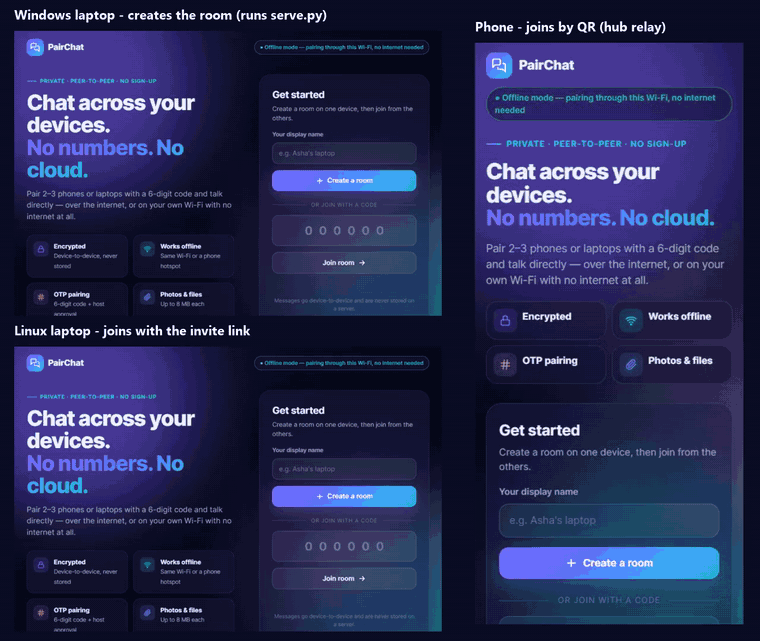

▶ **[Watch the full demo video (MP4, 51 s)](docs/demo/pairchat-demo.mp4)**. It's a real recording of three browser windows on one laptop, running against the real hub. See [Proof](#proof) for the run on three physical devices.

---

## Contents
- [Why PairChat](#why-pairchat)
- [Features](#features)
- [Quick start (offline, same Wi-Fi or hotspot)](#quick-start-offline-same-wi-fi-or-hotspot)
- [Online mode (devices anywhere)](#online-mode-devices-anywhere)
- [How it works](#how-it-works) (architecture, pairing, connection, messages)
- [Security and privacy](#security-and-privacy)
- [Proof](#proof) (video, screenshots, real-device field test, automated tests)
- [Project structure](#project-structure)
- [Hub protocol reference](#hub-protocol-reference)
- [Configuration](#configuration)
- [Troubleshooting](#troubleshooting)
- [Limits and roadmap](#limits-and-roadmap)
- [How it compares](#how-it-compares)
- [Re-recording the demo and diagrams](#re-recording-the-demo-and-diagrams)
- [License and credits](#license-and-credits)

---

## Why PairChat

Most messengers identify you by **phone number** (WhatsApp, Signal, Telegram) or need you to type an **IP address** to talk on a local network. PairChat identifies a conversation by a **short-lived 6-digit room code** instead, so:

- **no phone number, email or account** is needed
- **no IP address to type**: the invite QR code carries the address
- **no internet**: a laptop on your Wi-Fi or hotspot does the pairing
- **nothing to install** on the phones: it's a web page

## Features

| | |
|---|---|
| 🔢 **OTP-style pairing** | 6-digit room code, invite link and **QR code**; the code fills in automatically |
| ✅ **Host approval** | every device must be accepted by the host; the host can **Lock** the room |
| 📶 **Offline mode** | `serve.py` serves the app *and* does the pairing on your LAN or hotspot |
| 🌍 **Online mode** | host the folder on any static site; pairing uses the free PeerJS broker |
| 🔒 **Direct and encrypted** | WebRTC data channels (DTLS) between devices |
| 🛟 **Automatic relay** | if a hotspot blocks direct links, chat goes through the laptop hub instead |
| 💬 **Chat** | text, photos and files up to 8 MB, typing indicator, ✓ delivered ticks, avatars |
| 👥 **2–3 devices** | configurable (`MAX_DEVICES`) |
| 🧪 **Self-test page** | `check.html` tests every step and reports PASS/FAIL to the hub console |
| 🎨 **Modern UI** | dark/light theme, built for phones, bundled font (works offline) |
| 🪶 **Zero dependencies** | Python standard library only; browser libraries bundled in `app/vendor/` |

## Quick start (offline, same Wi-Fi or hotspot)

You need **Python 3.8+** on one laptop. The other devices only need a browser.

```bash
git clone https://github.com/Lukesh2006/pairchat.git
cd pairchat
python app/serve.py
```

1. The app opens in your browser. The first time on Windows, allow Python through the firewall on **Private networks**.
2. Enter a name and click **Create a room**. The **Invite** panel shows the code, a QR code and a link.
3. On each phone or laptop, **scan the QR code** or open the link. Enter a name and tap **Join room**.
4. Tap **Accept** on the host. You're chatting.

> **Run exactly one hub.** Rooms only exist on the hub that created them. `serve.py` warns you if another hub is already running.

No router? Turn on a **phone hotspot** and connect the laptop to it. Every device joins that hotspot.

## Online mode (devices anywhere)

Upload the `app/` folder to any static host (GitHub Pages, Netlify Drop, Cloudflare Pages). Open the `https://…` URL, create a room, then tap **Invite → Share…** (WhatsApp, Telegram, email…) or **Copy link**. Pairing then goes through the free PeerJS cloud broker (`0.peerjs.com`), and the devices can be on different networks.

The page decides the mode by itself: if `serve.py` is serving it (it answers `/pairchat-local.json`), it uses the local hub; otherwise it uses the cloud broker.

---

## How it works

### Architecture

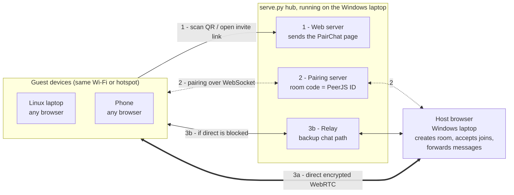

`serve.py` is about 400 lines of standard-library Python and plays three roles:

1. **Web server.** It sends `index.html` and the bundled libraries to every device, so phones need nothing installed.
2. **Pairing server.** It's a minimal, **PeerJS-compatible signalling server** over WebSocket (implemented from scratch: RFC 6455 handshake and framing). A room is a PeerJS peer with the ID `pairchat-v1-<code>`; joining means sending that ID a WebRTC offer.
3. **Relay.** It forwards chat for devices that can't open a direct link (`RELAY` messages, chunked for files).

The **host's browser** is the centre of a star. Guests talk to the host, and the host forwards every message to the others and stamps the sender's identity, so a guest can't pretend to be someone else.

### Pairing: what happens when you join

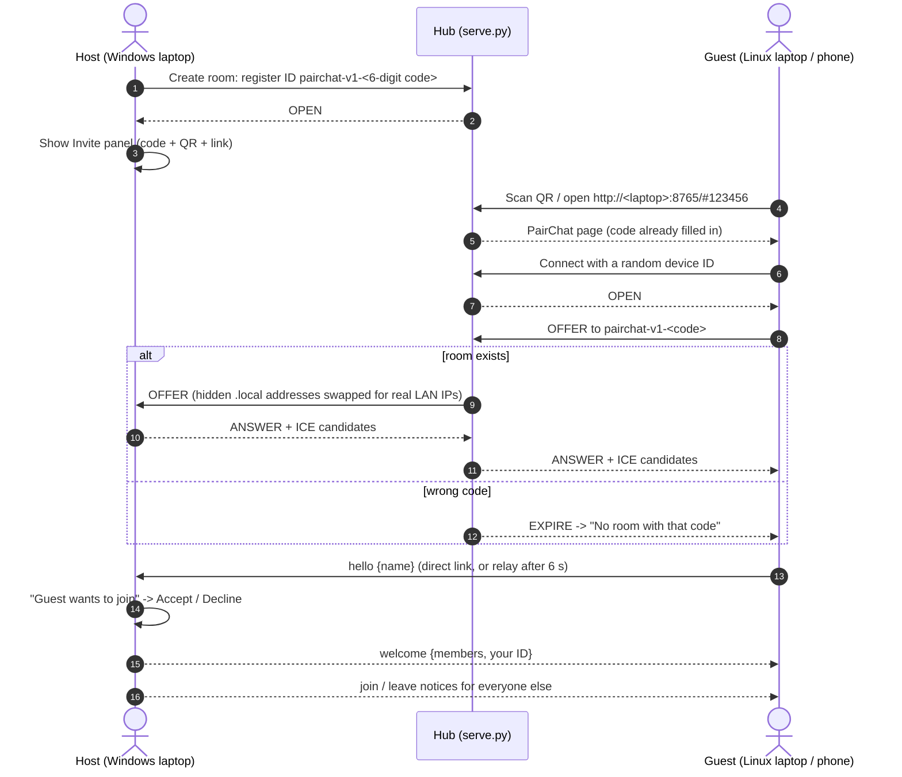

**Why the hub rewrites addresses:** browsers hide their local IP behind random `xxxxxxxx-….local` names (mDNS) for privacy. Many phones and hotspots can't resolve those names, so the direct link never opens. The hub already knows each device's real address on the network, so it swaps the real address into the connection details it forwards.

### Connection: direct or relay?

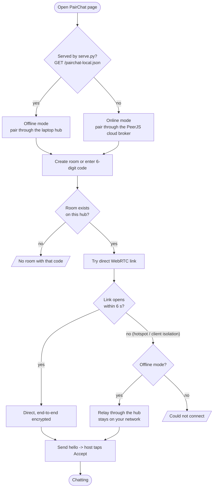

### Messages and files

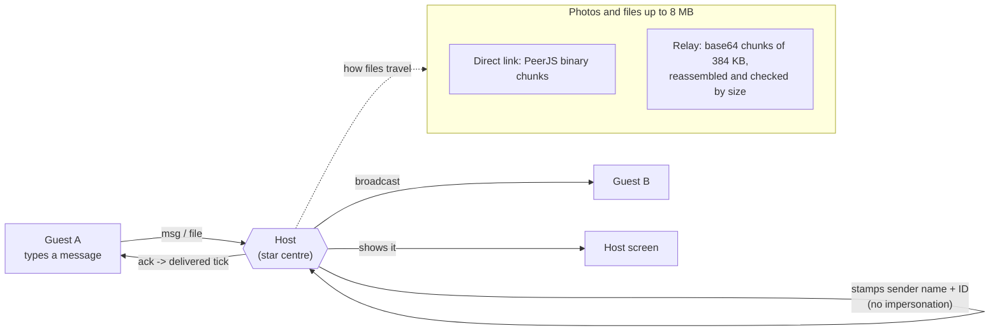

Image copies of every diagram (PNG and SVG) are in [`docs/diagrams/`](docs/diagrams), for reports and slides.

---

## Security and privacy

| Aspect | How PairChat handles it |
|---|---|
| Identity | No phone number, email or account. Display names are chosen per session. |
| Getting in | Knowing the 6-digit code isn't enough: the **host must accept** each device. The host can **Lock** the room. At most 3 devices. |
| Direct chat | WebRTC data channels, encrypted with **DTLS** between the two browsers. |
| Relay chat | Goes through the laptop hub on **your own network**. On this path it is **not end-to-end encrypted**: whoever runs the hub could read it. |
| Signalling | The hub (or the PeerJS broker online) only sees peer IDs and connection details, never direct-link messages. |
| Storage | **Nothing is stored.** Closing the tab erases the chat. No database, no logs of message content. |
| Impersonation | The host stamps every forwarded message with the real sender's name and ID. |
| Untrusted content | All messages are rendered as text (`textContent`). Files are offered as downloads, never executed. |
| What's served | `serve.py` serves only the `app/` folder; repository files and `..` paths are not reachable (covered by a test). |

## Proof

### 1. Demo video
[`docs/demo/pairchat-demo.mp4`](docs/demo/pairchat-demo.mp4) (51 s) and the GIF above were recorded by [`tools/record_demo.py`](tools/record_demo.py). It starts a real hub and drives **three real Microsoft Edge windows** (a "Windows laptop", a "Linux laptop" and a phone-sized screen), recording each one:

1. The Windows laptop creates a room → Invite panel with code and QR.
2. The Linux laptop opens the invite link (over the laptop's **network address**, not localhost) and joins → host accepts.
3. The phone joins through the **hub relay**, the path a phone hotspot falls back to → host accepts.
4. All three chat; the phone sends a **photo** that arrives on both laptops; ✓ delivered ticks.
5. The phone leaves; the others see "Phone left".

The hub's own console output from that recording is in [`docs/demo/demo-hub-log.txt`](docs/demo/demo-hub-log.txt).

### 2. Screenshots

| Home | Invite (code + QR) | Join request |
|---|---|---|
| 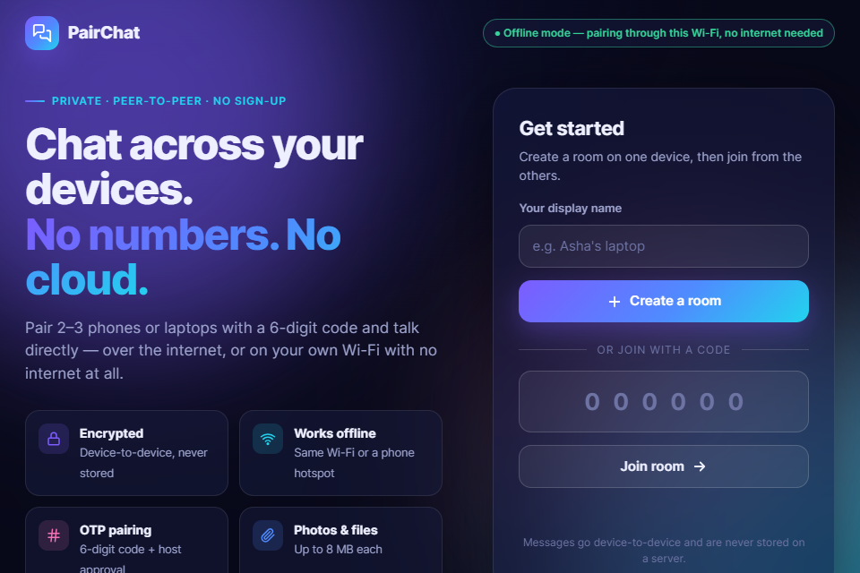 | 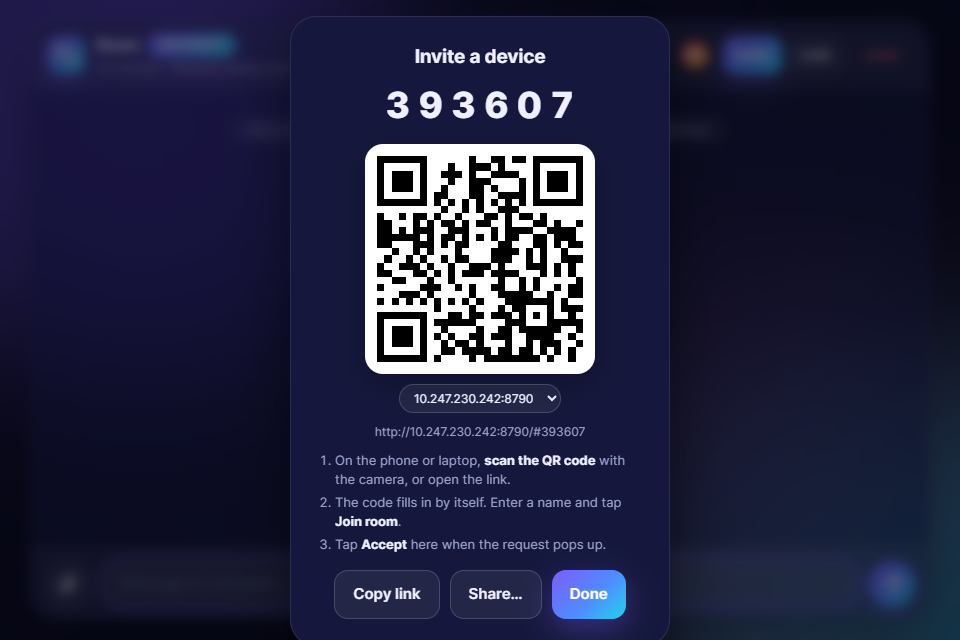 | 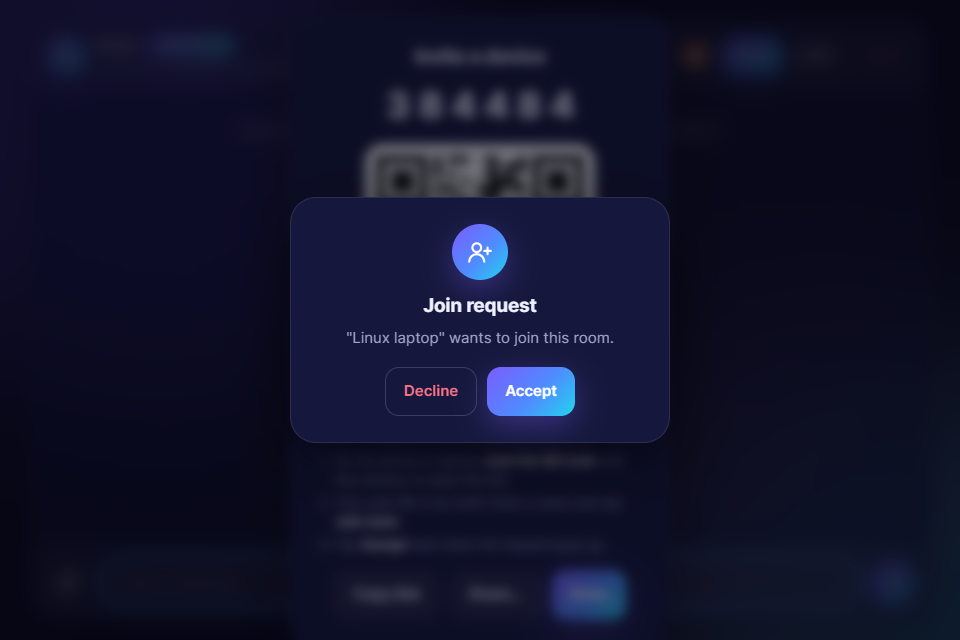 |

| Phone: opened from invite | Laptop chat | Phone chat |
|---|---|---|
| 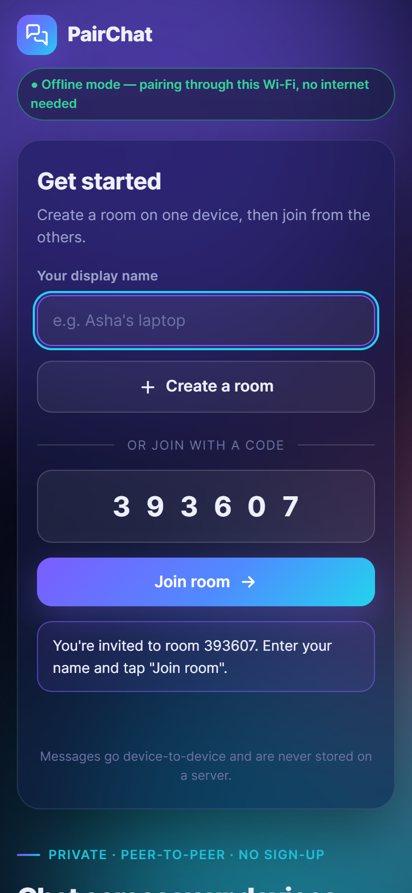 | 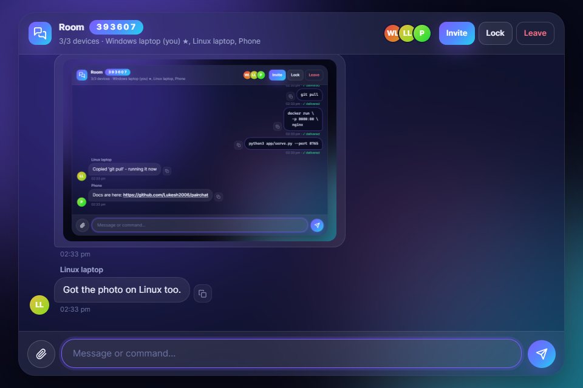 | 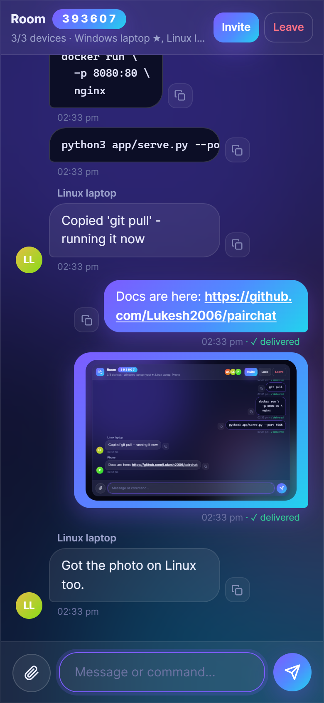 |

### 3. Field test on three physical devices
On 2026-11-25, PairChat was tested on a **Windows laptop** (hub and host), a **Linux laptop (Firefox 154)** and an **Android phone (Chrome)**, all connected to the phone's hotspot. Three real-world bugs turned up and were fixed. Details and hub logs are in **[docs/FIELD_TEST.md](docs/FIELD_TEST.md)**.

### 4. Automated tests
```bash
python -m unittest discover -s tests -v
```
15 tests in [`tests/test_hub.py`](tests/test_hub.py) start a real hub and talk to it like a browser: page serving, hub discovery, ID generation, path-traversal protection, **HTTP/1.1 WebSocket handshake** (the Firefox fix), duplicate room codes, wrong codes, offer forwarding, relay plus departure notices, large relayed chunks, and the mDNS address rewrite rules.

---

## Project structure

```
pairchat/
├── app/                      ← everything a device needs (this folder is what gets served)
│   ├── index.html            the whole chat app (UI + logic, ~1,000 lines, no build step)
│   ├── check.html            connection self-test page
│   ├── serve.py              offline hub: web server + pairing server + relay (stdlib only)
│   └── vendor/               PeerJS 1.5.4, qrcode-generator 1.4.4, Inter font
├── docs/
│   ├── FIELD_TEST.md         real three-device test report
│   ├── demo/                 demo video, GIF, hub log
│   ├── diagrams/             Mermaid sources + rendered PNG/SVG
│   └── screenshots/
├── tests/test_hub.py         end-to-end hub tests (stdlib only)
└── tools/
    ├── record_demo.py        records the demo video (Playwright + Edge)
    ├── render_diagrams.py    renders the Mermaid diagrams
    └── requirements-demo.txt only for tools/
```

## Hub protocol reference

| Endpoint | Purpose |
|---|---|
| `GET /` | the app (`app/index.html`) and static files from `app/` |
| `GET /pairchat-local.json` | `{"local": true, "lanUrls": [...]}`: tells the page it's in offline mode and which address to put in the invite QR |
| `GET /peerjs/id` | random device ID (PeerJS protocol) |
| `GET /peerjs?key=peerjs&id=…&token=…` | WebSocket upgrade (pairing) |
| `POST /check-report` | `check.html` posts its PASS/FAIL results, printed in the console |

WebSocket messages (JSON):

| Type | Direction | Meaning |
|---|---|---|
| `OPEN` | hub → device | registered |
| `ID-TAKEN` | hub → device | room code already in use |
| `OFFER` / `ANSWER` / `CANDIDATE` / `LEAVE` | device ↔ device via hub | WebRTC signalling (PeerJS format, `.local` addresses rewritten) |
| `EXPIRE` | hub → device | no such room |
| `HEARTBEAT` | device → hub | keep-alive every 5 s |
| `RELAY` | device ↔ device via hub | chat payload when a direct link is blocked |
| `RELAY-FAIL` / `RELAY-GONE` | hub → device | relay target missing / disconnected |

App messages (direct or relayed): `hello`, `welcome`, `reject`, `msg`, `file`, `ack`, `typing`, `join`, `leave`, `end`.

## Configuration

| Setting | Where | Default |
|---|---|---|
| Port | `python app/serve.py --port 8766` | 8765 |
| Don't open a browser | `--no-browser` | opens one |
| Max devices per room | `MAX_DEVICES` in `app/index.html` | 3 |
| Max file size | `MAX_FILE_MB` in `app/index.html` | 8 MB |
| Time before relay fallback | `DIRECT_TIMEOUT_MS` in `app/index.html` | 6000 ms |
| Force the relay | add `?relay` to the URL, e.g. `http://<laptop>:8765/?relay#123456` | off |

## Troubleshooting

The hub prints what it's doing:

```
[hub] device 10.247.230.152 opened the app
[hub] device 10.247.230.152 connected for pairing (Firefox on Linux)
[hub] join request for room 146271 from 10.247.230.128
[hub] device 02419a <-> room 146271: direct link unavailable, relaying chat through this laptop
```

| Symptom | Fix |
|---|---|
| A device can't join, for any reason | Open `http://<laptop>:8765/check.html` on it. It tests every step and prints PASS/FAIL on screen and in the hub console. |
| "No room with that code" but the room exists | Two hubs are running. Use **one** `serve.py`; open devices through its QR code or link. |
| Stuck on "Connecting…" | Restart `serve.py` and reload the page (**Ctrl+Shift+R**). The relay fallback kicks in after 6 s. |
| "device … opened the app" never appears | The device can't reach the laptop: same Wi-Fi or hotspot? Windows Firewall → allow Python on **Private** networks. |
| Works at home, not at the office or a hotel | That Wi-Fi isolates clients. Use a phone hotspot. |
| Changed `serve.py` but nothing changed | A running hub keeps the old code. Restart it. |

## Limits and roadmap

| Limit | Possible next step |
|---|---|
| Offline mode needs one laptop running `serve.py`; phones alone can't do it | Native Android app on Google **Nearby Connections** (Bluetooth / Wi-Fi Direct) using the same message protocol |
| No Bluetooth (browsers can't advertise over Bluetooth) | Same native app |
| The room ends when the host leaves (star topology) | Host migration, or a full mesh (fine for 3 devices) |
| The relay path isn't end-to-end encrypted | Encrypt payloads with a key derived from the room code (needs HTTPS for WebCrypto on phones) |
| No history | Optional per-room IndexedDB storage |

## How it compares

| App | Phone number? | Works without internet | Needs install | Pairing |
|---|---|---|---|---|
| **PairChat** | No | ✅ (laptop hub) | No (browser) | 6-digit code + QR + host approval |
| Briar | No | ✅ (Bluetooth / Wi-Fi) | Yes (Android) | QR in person |
| Berty | No | ✅ (BLE / LAN) | Yes | QR / link |
| Bridgefy | No | ✅ (Bluetooth mesh) | Yes | nearby |
| Session / Jami | No | Jami on LAN | Yes | ID / QR |
| WhatsApp / Signal | **Yes** | ❌ | Yes | phone number |

## Re-recording the demo and diagrams

```bash
pip install -r tools/requirements-demo.txt
python -m playwright install ffmpeg      # small video encoder; browsers are your installed Edge/Chrome
python tools/record_demo.py              # → docs/demo/pairchat-demo.mp4 + .gif, docs/screenshots/*
python tools/render_diagrams.py          # → docs/diagrams/*.png / *.svg
```

## License and credits

PairChat is released under the [MIT License](LICENSE).

Bundled third-party files (see [`app/vendor/NOTICE.md`](app/vendor/NOTICE.md)):
- [PeerJS](https://github.com/peers/peerjs) 1.5.4, MIT
- [qrcode-generator](https://github.com/kazuhikoarase/qrcode-generator) 1.4.4 by Kazuhiko Arase, MIT
- [Inter](https://github.com/rsms/inter) typeface by Rasmus Andersson, SIL Open Font License 1.1
